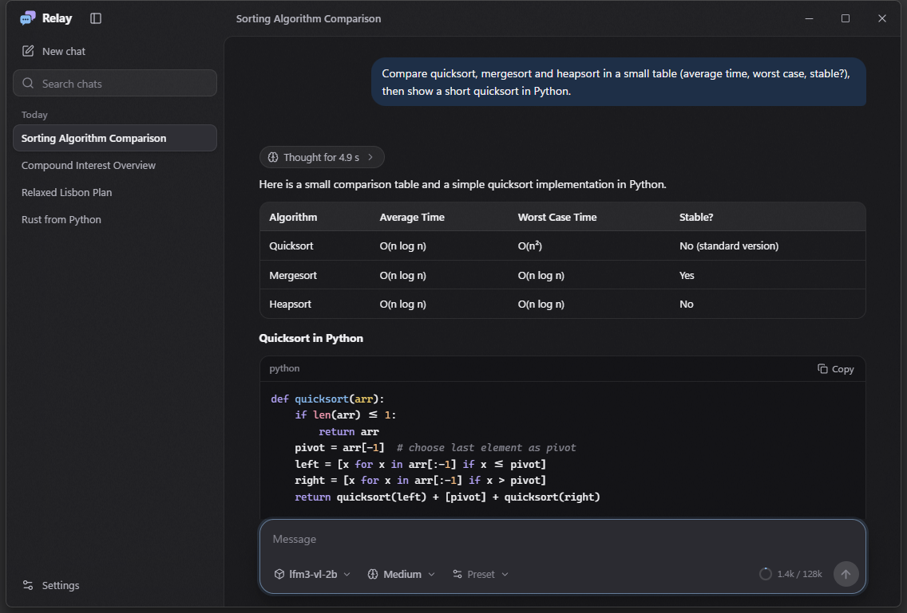
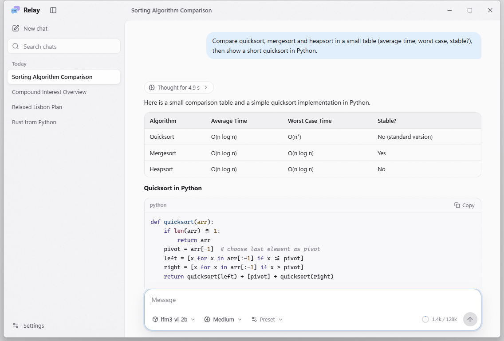
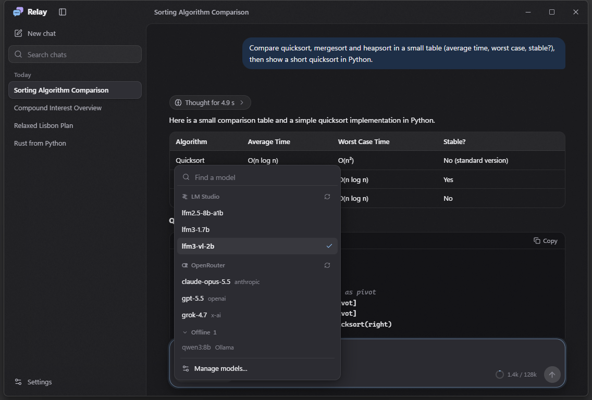
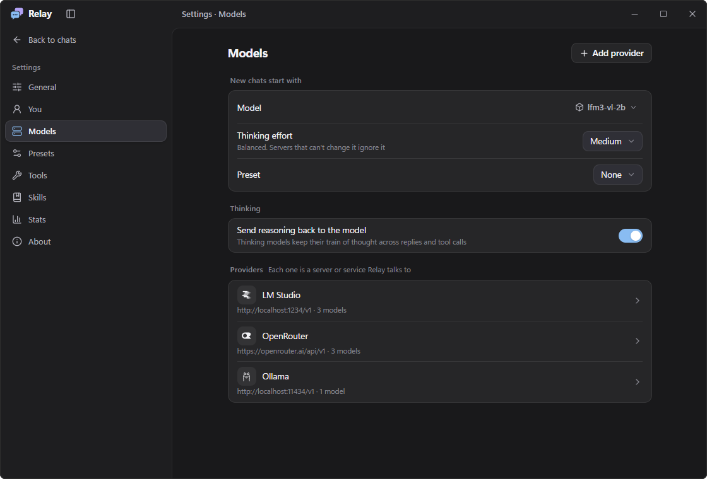

<p align="center">
  
</p>

<h1 align="center">Relay</h1>

<p align="center">
  <b>A calm chat client for your models.</b><br>
  Local servers like Ollama and LM Studio, or any OpenAI-compatible API, in one native Windows 11 window that lives in the Holster dock.
</p>

<p align="center">
  
  
  
  <a href="LICENSE"></a>
</p>

<p align="center">
  
</p>

---

## Highlights

- **Any OpenAI-compatible endpoint.** Ollama, LM Studio, llama.cpp, vLLM, OpenAI, OpenRouter, or your own server. Add it once with its address, test the connection, and its models show up in the picker. A server with more models than you want (LM Studio) can show only the ones you pick. Each provider shows its service's logo, or an icon or image you choose.
- **Files, pictures, sound and video.** Attach with the paperclip, drop files on the chat, or paste a screenshot. Each model gets everything it can take: images as images, audio as audio, video whole to models that watch video (else as stills, plus its sound for models that hear), PDFs as files where the server reads them (else their text), and Word, PowerPoint, code and text files as text. Relay knows what each model takes where the server says (LM Studio, Ollama, llama.cpp, OpenRouter) or from its name, warns before you send something it may not take, and lets you correct it per model.
- **Voice messages.** Press the mic, talk, press it again: the recording goes to the model as audio, so a model that hears gets your voice itself, not a transcript.
- **Knows what's online.** The model picker checks your servers each time it opens: models that can't answer right now wait in a folded *Offline* section, and new models on a server appear by themselves.
- **Tools through MCP.** Add MCP servers by command (`npx`, `uvx`, anything) or by address (Streamable HTTP), or import a Claude Desktop config. Relay asks before every tool call (*Allow once*, *Always allow*, *Deny*), and each tool can be set to Ask, Allow or Off.
- **Skills.** Folders of instructions, references and scripts in the Agent Skills format (`SKILL.md`). Models see each skill's name and description and load the rest when a task calls for it; scripts run only after you say yes (or once you trust that skill).
- **Edit, retry, branch.** Edit any of your messages or try a reply again, with the same model or another one. Every version is kept: switch between them with ‹ 1 / 3 ›.
- **Thinking effort.** Off, Low, Medium, High, Extra high or Max per chat, sent the ways servers understand it (`reasoning_effort`, chat-template options). A server that only knows up to High gets High.
- **It knows you.** Tell Relay your name, what you do and how you like answers in **You**; it's added to every chat, and you can see exactly what models see.
- **Presets.** Saved system prompts with their own temperature, top P, length and effort. Pick one per chat, or make one the default.
- **Streaming that survives anything.** Replies stream in the background: switch chats, close the window to the tray, or reload, and nothing is lost. `Esc` stops a reply.
- **Reasoning, shown calmly.** Thinking models (`reasoning_content`, `reasoning`, or inline `<think>` tags) get a folding "Thought for 12 s" section. Their thinking goes back to the model with earlier replies and tool calls (as `reasoning_content`), so it keeps its train of thought; turn that off in Settings → Models. A server that refuses the field gets the chat without it.
- **Rich answers.** Markdown, tables, syntax-highlighted code with one-click copy, and LaTeX math.
- **Stats.** Speed, tokens and time to first token under every reply; a context meter in the composer; and a Stats page with tokens per day and a table per model.
- **History and search.** Every chat is kept locally and searchable by title and content. Pin the ones you come back to; archive the ones you're done with (they wait in a folded *Archived* group, still searchable, and come back when you write in them). New chats get a short title from the chat's model or one you choose (a small, fast one is plenty).
- **Kind to your server's cache.** Nothing in a request changes from one message to the next except the new part: the system prompt stays put, each message carries its own time, and a title made on the same server comes before the reply. Local servers reuse their prompt cache instead of reading the whole chat again.
- **Holster-native.** Hover Relay's tile in [Holster](https://github.com/ManyGlue0/Holster) to see your latest chats; click one to jump in. When a reply finishes while Relay is in the background, a notification tells you.

## Screenshots

| Light mode | The model picker |
|---|---|
|  |  |

<p align="center">
  
</p>

## Install

Download `Relay_<version>_x64-setup.exe` from the [latest release](https://github.com/ManyGlue0/Relay/releases/latest) and run it. It installs for your user only; no admin rights needed.

Relay is **Windows 11 only**: it's drawn with native Windows materials (acrylic, rounded corners).

**Updates:** Settings → About → **Check**. Relay downloads the new version from GitHub, checks its signature, and restarts by itself.

### In the Holster dock

Relay is a [Holster](https://github.com/ManyGlue0/Holster) app. Holster is a dock on the edge of your screen for your own tools. With Holster installed, Relay adds its tile by itself the first time it runs: hover it to see your latest chats, click one to jump in. Relay works fine without Holster too.

## Getting started

1. Open Relay and choose **Add a provider**.
2. Pick a preset (Ollama, LM Studio, llama.cpp, vLLM, OpenAI, Anthropic, SpaceXAI, OpenRouter) or type any address ending in `/v1`.
3. Add an API key if the service needs one, then **Test connection**.
4. Start typing. Optionally, tell Relay about yourself in **Settings → You**.

| Server | Default address |
|---|---|
| Ollama | `http://localhost:11434/v1` |
| LM Studio | `http://localhost:1234/v1` |
| llama.cpp (`llama-server`) | `http://localhost:8080/v1` |
| vLLM | `http://localhost:8000/v1` |
| OpenAI | `https://api.openai.com/v1` |
| Anthropic | `https://api.anthropic.com/v1` (its OpenAI-compatible API) |
| SpaceXAI (Grok) | `https://api.x.ai/v1` |
| OpenRouter | `https://openrouter.ai/api/v1` |

Endpoints that don't list their models can still be used: add model ids by hand in the provider's **Models** list. Relay detects each model's context window where the server says it (llama.cpp, LM Studio, Ollama, vLLM, OpenRouter); you can also set it by hand.

## Tools (MCP)

In **Settings → Tools**, add a server:

- **On this PC**: the command and its arguments, as you'd type them, e.g. `npx -y @modelcontextprotocol/server-filesystem C:\Users\me\Documents`. Environment variables (API keys) are kept in Windows Credential Manager.
- **On a server**: a Streamable HTTP address (usually ending in `/mcp`), with an optional bearer token.
- **Import**: paste the `mcpServers` JSON from Claude Desktop, Cursor or VS Code.

Tool servers start with Relay, run without a console window, and end when Relay quits.

## Skills

A skill teaches models one kind of task. It's a folder with a `SKILL.md` (a `name`, a `description`, then instructions in markdown) and whatever else it needs: references, templates, scripts. In **Settings → Skills** you can write one, or add one from a folder or a `.zip` / `.skill` file (adding a skill with the same name updates it).

- Models get each enabled skill's name and description. When a request fits, they load the skill's instructions, read its files, and run its scripts.
- Scripts (`.py`, `.js`, `.ps1`, `.sh`, `.bat`, `.cmd`, `.exe`) ask before every run, unless you turn on *Run scripts without asking* for that skill (or press *Always allow*). They run in Relay's workspace folder, without a console window, for up to 5 minutes. Python scripts need Python installed, and Node scripts need Node.
- Skills work in chats that use tools: the composer's Tools chip turns both off for a chat.

## Keyboard

| Keys | Does |
|---|---|
| `Enter` | Send (or `Ctrl+Enter`, if you choose that in Settings) |
| `Shift+Enter` | New line |
| `Esc` | Stop the reply, or close what's open |
| `Ctrl+N` | New chat |
| `Ctrl+K` | Search chats |
| `Ctrl+B` | Show or hide the sidebar |
| `Ctrl+,` | Settings |
| Double-click your message | Edit it |
| `Ctrl+V` in the message box | Paste a copied image or file |

## Privacy

- Everything stays on your computer: chats live in a SQLite database in `%APPDATA%\app.relay.desktop\`, and attached files in its `attachments` folder (removed when their chat is deleted).
- The microphone is only on while you record a voice message. Windows' microphone setting decides whether Relay may use it.
- API keys are stored in **Windows Credential Manager** (as `Relay/provider/…`), never in Relay's files.
- Relay only talks to the endpoints you add, plus Holster on `127.0.0.1`. Remote images in replies are shown as links, not fetched.

## Build from source

Requirements: Rust (stable), Node 22+, pnpm, and the [Tauri 2 prerequisites](https://tauri.app/start/prerequisites/) for Windows.

```powershell
git clone https://github.com/ManyGlue0/Relay.git
cd Relay
pnpm install
pnpm dev:app        # run "Relay Dev", which keeps its own data beside an installed Relay
pnpm tauri build    # installer in target\release\bundle\nsis\
cd src-tauri; cargo test
```

A build of your own doesn't update itself; [docs/RELEASING.md](docs/RELEASING.md) covers signed release builds and the updater.

## Credits

- Built with [Tauri](https://tauri.app), [React](https://react.dev), [Framer Motion](https://motion.dev), [Lucide](https://lucide.dev) icons, [KaTeX](https://katex.org), [highlight.js](https://highlightjs.org) (through lowlight), [react-markdown](https://github.com/remarkjs/react-markdown) and [rusqlite](https://github.com/rusqlite/rusqlite).
- Tools speak the [Model Context Protocol](https://modelcontextprotocol.io); skills follow the [Agent Skills](https://agentskills.io) format.
- The frameless acrylic window and the taskbar fix come from [Track](https://github.com/ManyGlue0/Track), by the same author.
- Telling money from math (`$5` vs `$x$`) follows the rule [Pandoc](https://pandoc.org) uses for TeX math.
- Provider logos come from [LobeHub Icons](https://github.com/lobehub/lobe-icons) (MIT), re-framed to sit centered. The logos and names are trademarks of their owners (OpenAI, Anthropic, SpaceX, OpenRouter, Ollama, LM Studio, vLLM); Relay uses them only to show which service a provider is, and isn't affiliated with any of them.

## License

[MIT](LICENSE)
